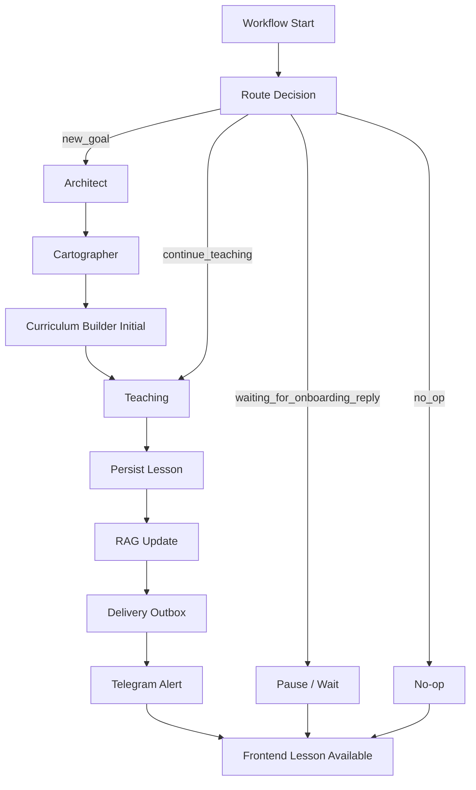

# LRNR - Agent Orchestration Routes
> **Agent and workflow route specification.**
> This file defines how LRNR agents are orchestrated across Phase 1, Phase 2, and Phase 3.

---

## Purpose

This file answers:

- which agent runs when
- what route decisions exist
- what each route reads and writes
- what state is passed between nodes
- when workflows pause
- when workflows no-op
- how Phase 1 expands into Phase 2 and Phase 3

This file supersedes older Telegram-first graph assumptions.

Current product direction:

```text
Frontend is the study cockpit.
Telegram is notification and alerting.
Backend orchestrates agents.
```

---

## Orchestration Principles

- One route decision should happen before agent execution.
- Routes must be logged.
- Workflow state must be typed.
- Every node must have clear inputs and outputs.
- Long-running work must create/update `job_runs`.
- Delivery must be idempotent.
- RAG writes must be idempotent.
- Frontend page loads should read persisted state, not trigger surprise LLM calls.
- Errors must be recorded and visible.
- Telegram alerts should point back to frontend.
- Use hybrid routing for efficiency: run nodes sequentially only when output dependency requires it, and run independent work in parallel with explicit fan-in.

---

## Hybrid Routing Rule

LRNR should not make every workflow purely sequential.

Use this rule:

```text
If node B needs node A's output, run A -> B sequentially.
If two nodes only need the same stable input and do not write conflicting state, run them in parallel.
If parallel nodes produce outputs needed by a later node, fan-in and validate before continuing.
```

Why:

- reduces workflow latency
- avoids unnecessary waiting
- keeps dependent reasoning safe
- prevents parallel writes from corrupting shared state

Allowed parallel work:

- load independent database records
- fetch multiple sources
- generate independent extraction passes
- compute metadata/ranking in parallel
- queue notifications while non-critical observability writes happen
- run health checks for system status

Do not parallelize:

- writes to the same authoritative row without a transaction/version check
- Curriculum Builder before Cartographer output exists
- Teaching before curriculum/session exists
- RAG summary before lesson/session content exists
- delivery before lesson persistence succeeds
- any node that depends on unvalidated LLM output

Fan-out/fan-in pattern:

```text
stable input
  -> parallel task A
  -> parallel task B
  -> parallel task C
  -> validate all outputs
  -> merge into one typed state update
  -> continue
```

Failure rule:

```text
If a critical parallel branch fails, fail the route safely.
If a non-critical branch fails, continue only if the route can still produce a correct result and the failure is logged.
```

Every parallel branch must state whether it is:

- critical
- optional
- retryable
- allowed to partially fail

---

## Phase 1 Hybrid Routing Map

Phase 1 still has a mostly sequential spine because the main outputs depend on each other:

```text
Architect -> Cartographer -> Curriculum Builder -> Teaching -> Persist -> Notify/RAG
```

But each stage can use internal parallelism safely.

### Sequential Dependencies

Must stay sequential:

```text
goal/onboarding
  -> Architect creates topic brief
  -> Cartographer researches from topic brief
  -> Curriculum Builder plans from research
  -> Teaching generates from curriculum/session
  -> lesson is persisted
  -> notification and RAG follow
```

### Safe Parallelism In Phase 1

Inside `load_context`:

```text
load profile
load active curriculum
load notification preferences
load latest job status
```

Inside `Cartographer`:

```text
fetch official docs
fetch examples/tutorials
fetch changelog/version notes
fetch source metadata
```

Then fan-in:

```text
validate source results
deduplicate
rank source quality
write topic_knowledge_base
```

Inside `Teaching` context preparation:

```text
load current session
load topic knowledge
load scoped RAG context
load Layer 3 empty/current context
```

After lesson persistence:

```text
write RAG session summary
queue Telegram alert
write non-critical trace/log metadata
```

Important:

```text
Telegram alert can run after lesson persistence.
RAG summary can run after lesson persistence.
Neither should happen before the lesson exists.
```

---

## Phase 1 Routes

Phase 1 has four main routes:

```text
new_goal
continue_teaching
waiting_for_onboarding_reply
no_op
```

Optional failure route:

```text
safe_failure_alert
```

---

## Phase 1 Route Decision

Decision inputs:

- owner user id
- active profile
- active topic
- active curriculum
- onboarding state
- current session status
- workflow lock status
- last delivery state

Decision logic:

```text
if workflow lock exists:
  route = no_op

else if onboarding is awaiting owner reply:
  route = waiting_for_onboarding_reply

else if no active topic or goal was newly submitted:
  route = new_goal

else if active curriculum has pending/ready session:
  route = continue_teaching

else:
  route = no_op
```

Phase 1 does not route to evaluation yet.

---

## Phase 1 Route A - `new_goal`

Purpose:

Start a new learning goal and produce the first lesson.

Flow:

```text
START
  -> create job_run
  -> acquire workflow lock
  -> Architect Agent
  -> write/update user_profile
  -> write topic_brief
  -> seed onboarding RAG
  -> Cartographer Agent
  -> write topic_knowledge_base
  -> Curriculum Builder Agent initial mode
  -> write curriculum_state
  -> Teaching Agent
  -> persist generated lesson
  -> write session summary RAG
  -> create delivery_outbox item
  -> Telegram alert processor sends alert/deep link
  -> mark job_run succeeded
  -> release workflow lock
END
```

Reads:

- submitted goal
- onboarding answers
- owner profile if it exists

Writes:

- `user_profile`
- `topic_briefs`
- `rag_memory`
- `topic_knowledge_base`
- `curriculum_state`
- `job_runs`
- `delivery_outbox`

Idempotency keys:

```text
goal-start:{userId}:{goalHash}
topic-brief:{userId}:{topicSlug}
rag-onboarding:{userId}:{onboardingId}:{turnHash}
curriculum-initial:{userId}:{topicSlug}
lesson-generate:{userId}:{sessionId}
delivery:{userId}:{sessionId}:lesson-ready
```

Done when:

- first lesson exists
- dashboard can load current lesson
- Telegram alert is queued/sent once
- workflow can rerun without duplicate writes

---

## Phase 1 Route B - `continue_teaching`

Purpose:

Generate or serve the next normal lesson for an existing active curriculum.

Flow:

```text
START
  -> create job_run
  -> acquire workflow lock
  -> load active curriculum
  -> load current session
  -> if lesson already generated:
       skip generation
     else:
       Teaching Agent generates lesson
       persist generated lesson
  -> write session summary RAG if lesson is delivered/completed and summary missing
  -> create delivery_outbox item if alert missing
  -> Telegram alert processor sends alert/deep link
  -> mark job_run succeeded
  -> release workflow lock
END
```

Reads:

- `user_profile`
- `curriculum_state`
- `topic_knowledge_base`
- scoped `rag_memory`

Writes:

- updated `curriculum_state`
- `rag_memory` session summary
- `delivery_outbox`
- `job_runs`

Rules:

- no duplicate lesson generation for same session
- no duplicate alert for same session
- no LLM call in normal `GET /api/lesson/current`

---

## Phase 1 Route C - `waiting_for_onboarding_reply`

Purpose:

Prevent workflow from pushing a lesson while onboarding is still interactive.

Flow:

```text
START
  -> detect onboarding awaiting reply
  -> do not run Cartographer
  -> do not run Curriculum Builder
  -> do not run Teaching
  -> return waiting status
END
```

Writes:

- optional `job_runs` no-op record

Rules:

- do not invent missing onboarding answers
- do not send repeated nag messages unless reminder behavior is explicitly enabled

---

## Phase 1 Route D - `no_op`

Purpose:

Exit cleanly when there is nothing safe to do.

No-op reasons:

- workflow already running
- no pending session
- current session already delivered
- topic complete
- missing required data
- configuration incomplete

Flow:

```text
START
  -> record no-op reason
  -> do not call LLM
  -> do not send duplicate Telegram alert
  -> return safe status
END
```

---

## Phase 1 Safe Failure Route

Purpose:

Make failures visible without corrupting state.

Failure behavior:

```text
node fails
  -> record error in job_runs
  -> do not mark session delivered
  -> do not write misleading RAG summary
  -> send safe workflow failure alert if configured
  -> release lock
```

Safe alert text should not include secrets, stack traces, or raw private content.

---

## Phase 1 State Shape

Recommended state:

```ts
interface Phase1LearningWorkflowState {
  requestId: string;
  runId: string;
  userId: string;
  route:
    | 'new_goal'
    | 'continue_teaching'
    | 'waiting_for_onboarding_reply'
    | 'no_op'
    | 'safe_failure_alert';
  goal?: string;
  profile?: UserProfile;
  topicBrief?: TopicBrief;
  curriculum?: CurriculumState;
  currentSession?: Layer2Session;
  topicKnowledgeBase?: TopicKnowledgeBase;
  ragContext?: RAGContextPack;
  generatedLesson?: LessonPayload;
  deliveryKey?: string;
  errors: Array<{
    node: string;
    code: string;
    message: string;
    retryable: boolean;
  }>;
}
```

State rules:

- state is passed between workflow nodes
- persisted truth remains in Postgres
- Redis can hold temporary run status
- do not store provider secrets in workflow state

---

## Phase 1 Node Contracts

### `route_node`

Reads:

- profile
- onboarding state
- curriculum state
- locks

Returns:

- route label
- no-op reason if applicable

### `architect_node`

Reads:

- goal
- onboarding conversation
- previous profile if any

Writes:

- profile summary
- topic brief
- onboarding RAG seed events

### `cartographer_node`

Reads:

- topic brief

Writes:

- topic knowledge base
- source inventory
- concept map

### `curriculum_builder_initial_node`

Reads:

- topic brief
- topic knowledge base
- profile

Writes:

- Layer 1 roadmap
- Layer 2 sessions
- current session pointer

### `teaching_node`

Reads:

- current session
- topic knowledge base
- profile
- scoped RAG context

Writes:

- generated lesson payload
- persisted session lesson content

### `rag_update_node`

Reads:

- onboarding output or delivered lesson/session summary

Writes:

- meaningful `rag_memory` rows

### `notification_node`

Reads:

- delivery payload
- notification preferences

Writes:

- `delivery_outbox`
- delivery status

---

## Phase 2 Route Expansion

Phase 2 adds:

```text
evaluation_due
reconcile_evaluation
```

Route decision addition:

```text
else if next_evaluation_due <= today and enough taught context exists:
  route = evaluation_due
```

Flow:

```text
evaluation_due
  -> Evaluation Agent
  -> evaluation_sessions write
  -> RAG gap/misconception/mastery writes
  -> learner_concept_mastery update
  -> agent_update_queue remediation writes
  -> Curriculum Builder reconcile mode
  -> update eligible future sessions
  -> notify owner
```

Protected window:

```text
Do not rewrite today's session.
Do not rewrite tomorrow's session.
Prefer N+2 and later.
```

---

## Phase 3 Route Expansion

Phase 3 adds background intelligence routes:

```text
daily_research
nightly_reconcile
contradiction_resolution
digest_delivery
```

Daily research flow:

```text
Scout Agent
  -> News Intelligence Agent
  -> Contradiction detection
  -> Layer 3 writes
  -> agent_update_queue writes
  -> news_items writes
```

Nightly reconcile flow:

```text
read agent_update_queue
  -> sort by priority
  -> process evaluation/scout/news/contradiction updates
  -> protect today/tomorrow
  -> update eligible future sessions
  -> mark queue items applied/rejected
```

---

## Orchestration Guardrails

- Do not run Evaluation in Phase 1.
- Do not run Scout/news in Phase 1.
- Do not run nightly broad reconcile in Phase 1.
- Do not mutate Layer 2 outside Curriculum Builder.
- Do not send Telegram lesson content as primary study surface.
- Do not mark delivery successful before persistence succeeds.
- Do not write RAG summaries for failed lessons.
- Do not keep workflow locks forever.
- Do not let one failed optional node corrupt authoritative state.

---

## Mermaid Overview



---

## Final Rule

The orchestrator should make LRNR predictable:

```text
One clear route.
Typed state.
Idempotent writes.
No duplicate delivery.
Frontend reads persisted truth.
Telegram only alerts.
Failures visible.
```
